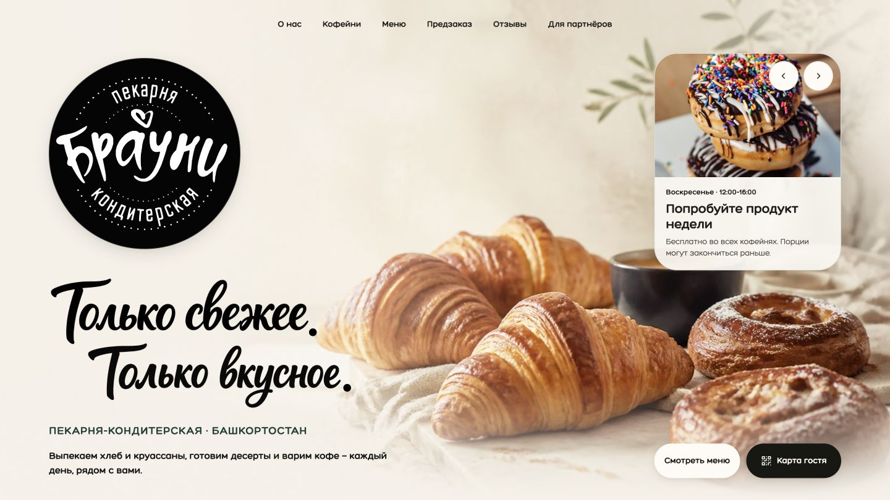
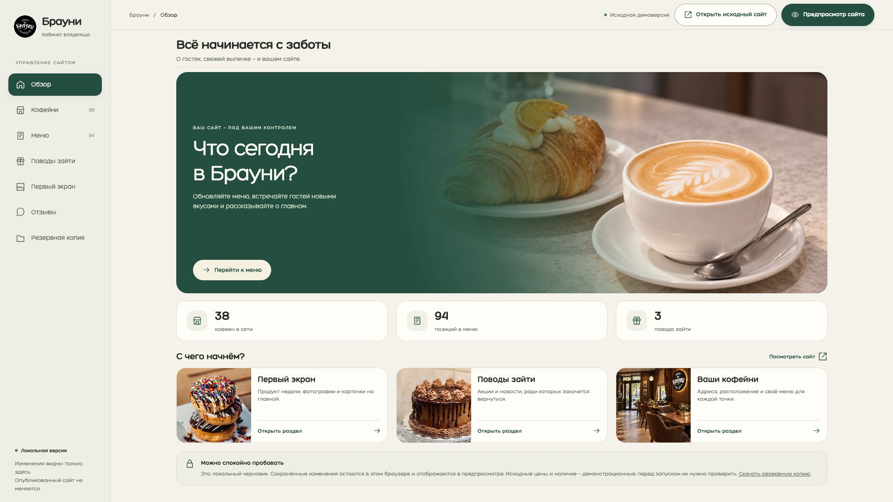

# Брауни

**Сайт сети кофеен и кабинет владельца**

[Открыть сайт](https://vagapov-studio.netlify.app/portfolio/brownie/site-hero-246/) · [Попробовать кабинет владельца](https://brownie-cabinet-demo.netlify.app/)

## Задача

Сделать удобным путь от выбора кофейни и знакомства с ассортиментом до корзины, а владельцу дать понятный инструмент для обновления сайта.

## Возможности

- Выбор кофейни на карте, адреса и время работы.
- Меню с категориями, фотографиями, ценами и наличием по точкам.
- Корзина, сценарий предзаказа, заказные торты и карта гостя.
- Кабинет для редактирования позиций, фотографий, цен и ассортимента каждой кофейни.
- Управление акциями, карточками первого экрана и отзывами.
- Предпросмотр правок, история изменений и восстановление сохранений.

## Реализация

HTML, CSS и JavaScript. Демо-кабинет использует локальное хранение данных в браузере; для рабочего запуска предусмотрено подключение общей базы и защищённого входа.

Проектирование сценариев, дизайн интерфейса, адаптация и разработка — Vagapov Studio.

## Кабинет владельца

## Статус

Интерактивное демо. Изменения в кабинете сохраняются в браузере посетителя и не меняют сайт для остальных. Реальная отправка заказов и SMS не подключены.

## Связаться

[Обсудить проект в Telegram](https://t.me/vagapov_studio) · [Написать на почту](mailto:vagapov.studio.pro@gmail.com) · [Сайт студии](https://vagapov-studio.netlify.app/)

---

Публичный кейс: описание, изображения и ссылки на демонстрацию. Исходный код проекта закрыт.
